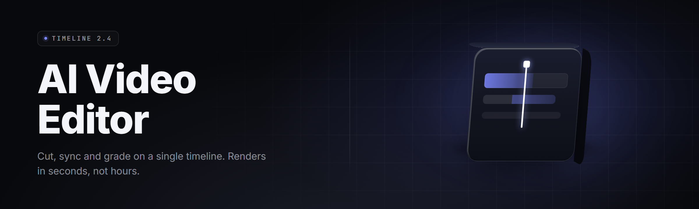

  
  
  

  

  
  
  

---

**AI Video Editor Toolkit 2026** — a shipped Windows `.exe` that cuts, captions, color-corrects, and renders short-form and long-form video using on-device models. No timeline subscription. No cloud upload. No watermarks.

---

## 📋 Table of Contents

- [Overview](#-overview)
- [What is AI Video Editor Toolkit](#-what-is-ai-video-editor-toolkit)
- [The Problem](#-the-problem)
- [The Solution](#-the-solution)
- [Comparison](#-comparison)
- [Key Features](#-key-features)
- [Grouped Module Catalog](#-grouped-module-catalog)
  - [Cut & Assembly Engine](#️-cut--assembly-engine)
  - [AI Speech & Caption Layer](#-ai-speech--caption-layer)
  - [Vision & Auto-Framing](#-vision--auto-framing)
  - [Color & Look Pipeline](#-color--look-pipeline)
  - [Audio Mastering Chain](#-audio-mastering-chain)
  - [Export & Delivery Rack](#-export--delivery-rack)
- [Tips for Best Results](#-tips-for-best-results)
- [System Requirements](#-system-requirements)
- [Compatibility / Platform Support](#-compatibility--platform-support)
- [Installation](#-installation)
- [Usage Guidelines](#-usage-guidelines)
- [Known Issues](#-known-issues)
- [FAQ](#-faq)

---

## 📼 Overview

The AI Video Editor Toolkit ships as a single portable `.exe`. You point it at a folder of raw clips, tell it what kind of video you want, and it does the boring 80%. Transcripts, captions, cut points, reframing, loudness normalization, and export presets all happen locally.

| Category | Details |
|---|---|
| Product | AI Video Editor Toolkit 2026 |
| Type | Desktop video editor (AI-assisted) |
| Distribution | Portable `.exe`, no installer bundling pip/npm |
| Runtime | Local inference — CUDA, DirectML, or CPU fallback |
| Format support | MP4, MOV, MKV, WEBM, MP3, WAV, AAC, plus RAW stills |
| Output | MP4 H.264/H.265, ProRes 422, AV1, WebM VP9, image sequence |
| First launch | ~12 seconds cold, ~3 seconds warm |
| GPU offload | NVIDIA (CUDA 12+), AMD/Intel (DirectML), Apple (Metal via WSL NO — Windows only) |

The toolkit is built for creators who cut volume — podcasters, short-form clippers, course authors, TikTok/Reels/Shorts producers, and post teams that need a first pass in minutes, not hours.

  

---

## 🎬 What is AI Video Editor Toolkit

A Windows-native, model-assisted NLE that behaves like a batch processor with a timeline view. Every "AI" tool runs on-device; nothing leaves your machine unless you press upload.

| Term | Explanation |
|---|---|
| **Cut Point** | A frame boundary where the engine proposes a scene or speech-context break. |
| **Transcript Index** | Time-aligned speech tokens used for text-based editing and caption sync. |
| **Auto-Frame** | Detection-driven reframing that follows speakers/faces for vertical outputs. |
| **Silence Map** | A per-second energy read that marks dead air and breath gaps. |
| **Loudness Target** | Program loudness measured in LUFS, matched per delivery preset. |
| **Look LUT** | A 3D color transform applied over the base grade with film-stock flavor. |
| **Render Graph** | The DAG the tool compiles before export; failures here are hard failures. |

Key benefits of running locally through one `.exe`:

- Speaker-aware cut suggestions with zero subscription.
- Whisper-class transcription that runs offline on a 6 GB GPU.
- Frame-perfect captions with style presets baked in.
- Vertical reframing that keeps faces centered through motion.
- Multi-cam auto sync via audio waveform alignment.
- Batch export queues for twelve export targets at once.

---

## 🕳️ The Problem

- Pro editors cost $20–$60/month and still make you cut every silence by hand.
- Cloud AI editors upload your raw footage and hit you with render quotas.
- Captions from "free" web tools drift out of sync past the 10-minute mark.
- Vertical reframing is done with a static crop — heads get chopped mid-sentence.
- Loudness on export changes clip to clip; platforms normalize them all differently.
- Multi-cam clips need manual syncing even when audio is right there.
- Batch pipelines require a render farm or a scripting degree.

---

## 🛠️ The Solution

| Problem | Solution |
|---|---|
| Hand-cutting silence | Silence Map auto-marks gaps; one-click ripple delete. |
| Cloud uploads | Everything runs local via the shipped `.exe`. |
| Caption drift | Transcript Index re-anchors every 250 ms against waveform. |
| Static vertical crop | Auto-Frame tracks faces and follows speaker changes. |
| Loudness chaos | Target-locked normalizer per delivery preset. |
| Manual multi-cam sync | Audio-waveform alignment under 1 frame error. |
| No batch | Export rack queues up to 24 presets in one run. |

---

## ⚖️ Comparison

| Aspect | Typical Cloud Editor | Typical Pro NLE | This Tool |
|---|---|---|---|
| Cost | $28/mo | $22/mo | One-time, MIT |
| Runs offline | No | Yes | Yes |
| Prime clip cutting | Paid add-on | Manual | Built-in |
| Waveform multi-cam sync | Rare | Paid module | Included |
| Reframe for 9:16 | Cropped center | Manual keyframes | Face-tracked |
| Batch presets | 3–5 | Manual export | 24 queue slots |
| Raw folder → export | Manual | Manual | Folder-drop pipeline |
| Text-based editing | Some | Paid beta | Included |

---

## 🎯 Key Features

| Feature | Description | Benefit |
|---|---|---|
| Silence Ripple Cut | Marks gaps in speech and auto-removes them | Shaves 15–40% runtime in minutes |
| Text-Based Editor | Edit dialogue by deleting words, not frames | Script-tight edits without scrubbing |
| Live Caption Engine | Streams transcript over the preview | No re-render per caption tweak |
| Auto Zoom (punch-ins) | Adds emphasis punch-ins on high-energy words | Short-form gets its natural rhythm |
| Speaker Diarization | Splits speakers so you can style each track | One clip, two characters, two captions |
| Chroma Repaint | GPU-backed key with spill suppression | Fast green-screen without plugins |
| Shot Stabilizer | Rolling-shutter aware motion fix | Handheld footage looks locked |
| Frame Interpolation | 24 → 60 fps optical flow optional | Slow-mo without stutter |
| Color Match Across Cams | Aligns look between A/B cams | Multi-cam cuts feel like one timeline |
| Whisper Transcription Overlay | On-device token stream visible in the timeline panel | Catch ASR mistakes before they hit export |
| Auto Thumbnail Picks | Ranks candidate frames by sharpness and face focus | Better thumbnails without scrubbing |
| De-noise (Video) | Spatially-aware noise reducer for high-ISO footage | Low-light clips usable |

---

## 🧩 Grouped Module Catalog

### ✂️ Cut & Assembly Engine

**Silence Ripple Cut** — Marks dead air over -38 dBFS and ripples the cuts.
**Beat Detector Cut** — Snaps cuts to music transient onsets.
**Scene Splitter** — Cuts on histogram and shot changes; tolerance is tuneable.
**Rule-Based Remover** — Drop any clip under X seconds, or under N words.
**Multi-Cam Syncer** — Two to eight angles aligned by embedded audio.
**Story Rewriter** — Reorders segments for opening–hook–body–CTA layouts.

### 🗣️ AI Speech & Caption Layer

**Whisper Stream** — Offline ASR with word-level timestamps.
**Filler & Breath Finder** — Marks "um," "uh," "like" and breath gaps.
**Caption Styler** — Karaoke, boxed, word-by-word, short-form styles.
**Bilingual Auto-Translate** — Subtitle track derived to a second language.
**Chapter Weaver** — Auto-generates YouTube chapters from topic shifts.

### 🎥 Vision & Auto-Framing

**Speaker Tracker** — Follows the active speaker across a locked session.
**Auto Reframe 16:9 → 9:16** — Keyframed, smooth across face motion.
**Face Tilt Feedback** — Flags clips where no face is dominant.
**Object Marker** — Highlights a chosen object through frames (manual confirm).

### 🎨 Color & Look Pipeline

**Auto Color Match** — Level, temp, and tint alignment between cams.
**Skin Tone Guard** — Holds skin targets while you push saturation.
**Log to Rec.709** — Common log profiles resolved on import.
**Look LUT Cache** — Live-previewable 3D LUTs at timeline speed.

### 🔊 Audio Mastering Chain

**LUFS Target Lock** — Podcast (-16), Broadcast (-23), Streaming (-14).
**Dynamic Range Controller** — Gentle clip-level glue compression.
**Duck-on-Voice** — Music beds auto-pump under spoken word.
**Room Reverb Sweep** — Mild wet/dry tuning for interview rooms.

### 📤 Export & Delivery Rack

**Preset Queue** — 24 slots: YouTube, Shorts, TikTok, Reels, X, LinkedIn.
**Split Chapters** — Deliver each chapter as separate file.
**Burn-in Modes** — Hard captions, soft SRT, or dual sidecar output.
**Per-Platform Naming** — Auto rename to timestamps and campaign tags.

---

## 🧠 Tips for Best Results

- Feed whole source folders, not single clips — the folder-drop reduces rebuild cost between runs.
- Record audio into a single mic where possible; the diarization module assumes separated energy.
- For multi-cam, keep at least the first second of both angles with motion; a written sync needs a beat.
- Do a full transcript pass before ANY caption styling — restyling re-lays a compiled graph.
- Set your target LUFS before export; multi-target queued renders use it per preset.
- Reframe last. Downstream order changes ripple to inference calls.

---

## 🖥️ System Requirements

| Component | Minimum | Recommended |
|---|---|---|
| OS | Windows 10 21H2 (build 19044) | Windows 11 23H2+ |
| CPU | 6-core x86_64 (2018+) | 12-core Zen 3 / Raptor Lake |
| RAM | 16 GB | 32 GB |
| GPU | DirectML capable (Vega / GTX 1060) | RTX 3060 12 GB / RX 6700 XT |
| VRAM | 6 GB | 12 GB+ |
| Storage | 40 GB free for tool + cache | 500 GB NVMe for projects |
| Runtime | .NET 8 + VC++ 2022 runtime | Same, pre-bundled |
| Microphone | Not required | Any USB or XLR interface |

Hardware-emoji only where it matters: 📼 for media I/O, 🎛️ for audio routing, 🖥️ for the desktop host.

---

## 🧷 Compatibility / Platform Support

| Platform | Status | Notes |
|---|---|---|
| Windows 11 23H2/24H2 | ✅ Full | CUDA/DML offload verified |
| Windows 10 21H2+ | ✅ Full | Tested 19044 → 19045 |
| Windows Server 2022 | 🟡 Partial | No GUI GPU share; CPU fallback works |
| Windows on ARM (SQ, QCOM) | 🟡 Beta | DirectML path, fewer presets |
| Linux (WINE 9) | ❌ Not supported | DirectML + Media Foundation dependencies |

---

## 📥 Installation

1. **Download and extract.**
   Move the `.exe` and its sidecar folder out of your Downloads directory into a stable location like `C:\Tools\AI Video Editor Toolkit\`. Keep the sidecar folder adjacent — the `.exe` resolves models relative to itself. Virus scanners may flag the bundled ASR downloader on first net call; allow it once.

2. **First-run setup.**
   Launch the `.exe`. The splash walks three checks — GPU enumerate, codec probe, and model unpack (about 1.8 GB onto disk). If you skip the model unpack, transcription and caption modules are disabled until you rerun setup.

3. **Point it at a project folder and hit Process.**
   Drop your source clips into a folder, open them, and hit Process. The queue runs cut → transcribe → caption → color → audio → export. Save presets once; subsequent runs are folder-drop → run.

  

---

## 🧭 Usage Guidelines

| Allowed | Not allowed |
|---|---|
| Your own footage, interview material, licensed music | Uploading footage you don't have rights to |
| On-device transcription of content you own | Circumventing copyright-protected delivery plugs |
| Plugin extension through the built-in script hook | Redistributing the `.exe` with a different name |
| Commercial client work as a paid editor | Cloud-restreaming the toolkit's render output as a paid service |

---

## 🧯 Known Issues

| Issue | Solution |
|---|---|
| ASR stalls on first launch | Warm start: close app, relaunch once to cache tokenizer weights |
| 8K H.265 import drops frames | Convert to ProRes or 10-bit H.264 proxy before import |
| Captions don't appear burned-in | Confirm the preset has "Burn" enabled, not "Sidecar only" |
| GPU out-of-memory on batch | Cut queue to 6 items, or enable sequential GPU reuse in Settings |
| DirectML fallback spins CPU during export | Cap export bitrate; CPU fallback is capped at 8 threads by default |
| .exe refuses to launch under a non-admin session | Right-click → Run as administrator on first setup only |

---

## ❓ FAQ

Does the .exe phone home?

No. Model weights ship with the app. The only outbound call is a self-check for updates, which you can disable under Settings → Privacy.

Can I run it fully offline?

Yes. Disable the update-check on first run, and every module (transcription, reframe, color match, export) works past that point with zero network.

What GPU do I actually need for whisper?

A 6 GB NVIDIA (GTX 1060 or newer) handles the base model at better-than-realtime. DirectML matching VRAM runs ~55% slower. CPU-only works but is 4–8× realtime on speech.

Is there a scripting hook?

Yes. Tools → Script Panel accepts JS overlays that can rewrite cut markers and caption styles. Exports can be triggered from scripts as well.

Can I use this commercially?

Yes. MIT-licensed, no royalties, no attribution on output. Just don't re-bundle the `.exe` and rename it.

**Q:** Why does Setup take longer than the docs claim?
**A:** Model unpack downloads a second bundle if the base model dir is missing; that path is unbounded by your disk speed.

**Q:** Can I run multiple instances at once?
**A:** One writer instance is enforced via a lock file. Read-only instances in preview mode are allowed.

**Q:** Does it read sidecar subtitle .SRT files?
**A:** Yes, on import even for overlapping layers — remember to rename them to match clip names, or lay them over the clip in the timeline.

**Q:** Where does the toolkit store renders?
**A:** Next to the source by default, or `/renders` inside the project folder if you flip "Preserve source layout" off.

---

## 🧊 Closing

The 2026 toolkit is a deliberate counterweight to the cloud-tax model of AI-assisted editing: every heavy lift runs on hardware you already own, outputs land in files you own, and no render runs against a quota. If you cut clips weekly and render several formats out the door, this replaces the paid stack you installed and never finished configuring. Updates ship quietly through the built-in self-check; the folder you extracted on day one is the same folder that will handle your twelfth batch pipeline this year.
